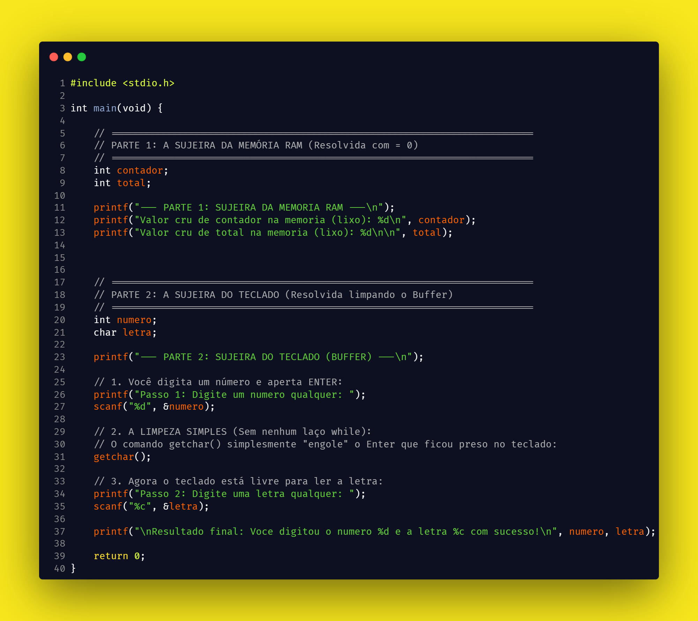
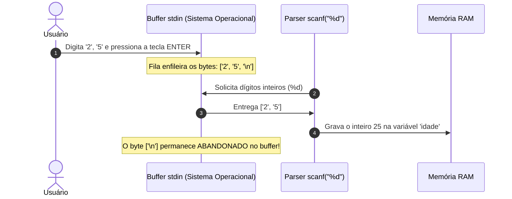
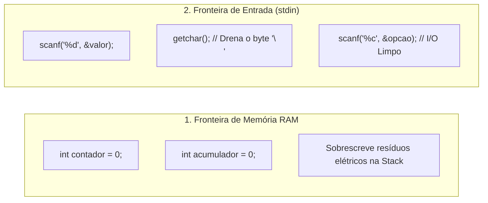

<div align="center">

# 🧠 O Fantasma de 1970: A Falha Arquitetural do C e o Crime do `\n` Abandonado
### *Da física dos transistores da memória RAM e das máquinas Teletype de 1970 ao ecossistema moderno: uma autópsia técnica e arquitetural sobre o lixo de memória e o crime do `\n` abandonado.*


[](https://www.linkedin.com/in/marcelflorentino/)
[](https://github.com/applephoria)

<br/>

> *"O C é peculiar, imperfeito e um sucesso estrondoso."*  
> — **Dennis M. Ritchie**, criador da Linguagem C e co-criador do Unix

</div>

---

> **Autor:** Marcel Florentino "Maçã"  
> **Tema:** Arquitetura de Sistemas Operacionais, Física da Memória RAM, Teletypes da Década de 1970 e Compiladores  
> **Classificação:** Artigo Técnico / Deep-Dive de Engenharia Forense

---

## 🧭 1. Introdução: O Preço do Acesso Direto ao Silício

A linguagem C, desenvolvida no início dos anos 70 nos laboratórios da Bell Labs por Dennis Ritchie, permanece como a fundação estrutural de praticamente todos os sistemas operacionais modernos (Linux, Windows, macOS), motores de bancos de dados relacionais e compiladores. O C foi projetado com um objetivo explícito e pragmático: **oferecer o máximo de eficiência computacional com o mínimo de abstração entre o código e o hardware.**

No entanto, essa proximidade visceral com o processador cobra um preço arquitetural severo. Ao contrário de linguagens de alto nível que interpõem camadas de segurança, coletores de lixo e abstrações de memória, o C expõe a realidade nua do computador:

1. **A ausência do conceito de "vazio":** Em tipos primitivos locais de C, não existe valor nulo (`null`). A memória RAM é física; qualquer variável não inicializada herdará o estado elétrico dos transistores alocados pelo Sistema Operacional.
2. **O modelo de fluxo de entrada baseado em terminais mecânicos:** A forma como funções padrão como `scanf` tratam a entrada do teclado é um reflexo direto de teleimpressores mecânicos da década de 1970, gerando um efeito colateral histórico que reverberou nas linguagens que vieram depois.

Este artigo realiza uma autópsia técnica sobre como esses dois pilares operam em nível de registradores e fluxo de I/O, apresentando os diagnósticos e os padrões de contenção de engenharia.

---

## 🔬 2. A Física da Memória Stack e o Mito do "Valor Nulo"

Em linguagens gerenciadas modernas, variáveis não atribuídas são frequentemente inicializadas por padrão com zeros ou bloqueadas em tempo de compilação. Em C, isso não ocorre por uma decisão consciente de arquitetura: **a economia de ciclos de instrução do processador**.

### A Mecânica da Alocação na Stack

Quando uma função é invocada em C, o compilador apenas move o ponteiro da pilha (*Stack Pointer* — registrador `RSP` em arquiteturas x86-64) para reservar o espaço de bytes necessário:

```
        ESTRUTURA DA MEMÓRIA STACK DURANTE A EXECUÇÃO
 ┌─────────────────────────────────────────────────────────────┐
 │  Endereço Anterior (Função Finalizada pelo SO / Processo)   │
 │  [ Transistores mantêm carga elétrica residual: 0x004018A8 ]│
 ├─────────────────────────────────────────────────────────────┤ <-- RSP recuado
 │  Nova Função: int contador; int total;                      │
 │  NENHUMA instrução de limpeza (XOR/MOV 0) é disparada!      │
 │  Resultado: As variáveis nascem com o LIXO DE MEMÓRIA       │
 └─────────────────────────────────────────────────────────────┘
```

A CPU **não zera** essa área. Limpar 4 ou 8 bytes na Stack para cada variável local exigiria instruções adicionais de máquina que reduziriam a velocidade de execução em sistemas de tempo real.

O resultado é que a variável herda o que a literatura técnica define como **Lixo de Memória** (*Garbage Value*).

### A Prova Pericial em Código:

O experimento forense completo demonstra tanto a persistência do lixo elétrico na Stack quanto a retenção indevida do `\n` no fluxo do teclado:

<div align="center">
  <br/>
  
  <br/>
  <sub><i>Demonstração pericial no padrão visual Carbon (Tema Blackboard sobre Amarelo Vibrante). Código de referência: <a href="src/01_lixo_memoria.c">src/01_lixo_memoria.c</a></i></sub>
  <br/><br/>
</div>

Ao executar este binário, a saída não exibe zeros previsíveis. Ela exibe resíduos imprevisíveis deixados pelo processo de inicialização do executável pelo sistema operacional:
```text
Valor cru de contador: 16
Valor cru de total:    4201048
```

Se este `total` for utilizado em uma rotina acumuladora (`total = total + nota`), o cálculo matemático inicia corrompido desde a primeira iteração.

---

## 📜 3. A Falha Arquitetural de 1970: A Herança das Teletypes e o Crime do `\n`

Se a gestão de variáveis expõe a crueldade da memória RAM, o tratamento de entrada padrão (`stdin`) revela uma limitação histórica que nasceu na década de 1970 e persiste até os dias de hoje.

### O Contexto Histórico: Teleimpressores Mecânicos (TTY)

Em 1972, os terminais computacionais eram equipamentos eletromecânicos acoplados a rolos de papel conhecidos como **Teletypes (TTY)**:

```
       MÁQUINA TELETYPE (DÉCADA DE 1970)
 ┌─────────────────────────────────────────────────┐
 │ [ Teclado ] ---> [ Disparo Mecânico de Linha ]  │
 │                                                 │
 │ A tecla ENTER acionava dois comandos físicos:   │
 │ 1. Retorno do Carro (CR - Carriage Return)      │
 │ 2. Avanço de Linha (LF - Line Feed: '\n')       │
 └─────────────────────────────────────────────────┘
```

No ecossistema Unix, todo dispositivo de entrada foi abstraído como um **fluxo contínuo de bytes (`stream`)**. Para o sistema operacional, a tecla **ENTER** não significa "enviar dados"; ela é tratada literalmente como o caractere de quebra de linha **`\n` (código ASCII 10 / 0x0A)**.

### O Comportamento Causal da Função `scanf`

Considere o caso em que um programa precisa ler um valor numérico seguido de uma opção de caractere:

```c
int idade;
char opcao;

printf("Digite a idade: ");
scanf("%d", &idade);

printf("Deseja cadastrar outro usuario? (S/N): ");
scanf("%c", &opcao); // <-- O FLUXO DE EXECUÇÃO PULA ESTA LINHA!
```

O diagnóstico pericial desse erro reside na assimetria de consumo da fila de entrada (`stdin`):



1. O especificador `%d` processa exclusivamente os caracteres numéricos `'2'` e `'5'`. Ao encontrar o delimitador `'\n'`, ele interrompe o parsing.
2. O valor `25` é gravado na variável `idade`. **Porém, o byte `\n` permanece abandonado no buffer de entrada.**
3. Quando a próxima linha executa `scanf("%c", &opcao)`, o especificador `%c` aceita **qualquer byte**, inclusive caracteres de controle como o `\n`.
4. O `scanf` consome imediatamente o `\n` remanescente, grava a quebra de linha na variável `opcao` e encerra a operação sem aguardar a digitação do usuário.

Se o programa tentar imprimir `printf("[%c]\n", opcao)`, o terminal executará uma quebra de linha física dentro dos colchetes, comprovando que a variável armazenou o Enter fantasma de 1970.

---

## 🧬 4. A Propagação da Herança Maldita em Outras Linguagens

Essa característica do fluxo de I/O de baixo nível não permaneceu isolada no C. Como a biblioteca de tempo de execução do C serviu como fundação para a implementação de dezenas de interpretadores e máquinas virtuais, o mesmo sintoma de buffer propagou-se para plataformas de alto nível.

Um exemplo clássico e notório ocorre no **Java**, dentro da biblioteca utilitária `java.util.Scanner`:

```java
Scanner scanner = new Scanner(System.in);

System.out.print("Digite a idade: ");
int idade = scanner.nextInt(); // Consome o número, mas deixa o '\n' no buffer!

System.out.print("Digite o nome completo: ");
String nome = scanner.nextLine(); // PULA A LEITURA! Consome o '\n' abandonado!
```

O erro que milhares de engenheiros de software enfrentam diariamente em Java não se origina na arquitetura orientada a objetos da linguagem; trata-se de um reflexo direto do comportamento do buffer de linha estabelecido há mais de cinco décadas nos laboratórios Bell.

---

## 🛡️ 5. O Padrão de Engenharia Defensiva

O domínio da infraestrutura de software exige o tratamento adequado dessas fronteiras. O padrão profissional de desenvolvimento divide a higienização em duas regras formais:



### Protocolo 1: Higienização da Memória (Inicialização Explícita)
* Toda variável que atua como **acumuladora** (`total += x`) ou **contadora** (`contador++`) deve nascer com **`= 0`** na sua declaração, anulando o lixo da Stack.
* Variáveis que apenas recebem dados diretos via sobrescrita externa dispensam inicialização redundante.

### Protocolo 2: Higienização de Fluxo (Drenagem do Buffer de I/O)
Sempre que alternar de uma leitura numérica para uma leitura de caracteres ou strings, o buffer deve ser explicitamente drenado:

```c
// Consome e descarta exatamente o byte residual '\n' do teclado:
getchar();
```

*(Como alternativa idiomática da ISO C, o uso do espaço no especificador `scanf(" %c", &opcao);` instrui formalmente o compilador a ignorar todos os whitespaces residuais antes da leitura).*

---

## 📸 6. Galeria de Códigos e Material para Apresentações

Para fins acadêmicos, palestras e inclusão em slides executivos (PowerPoint/Keynote), os códigos periciais deste estudo foram estruturados em cartões de alta resolução no diretório [`carbon_shots/`](carbon_shots/):

| Imagem do Card | Resolução | Assunto Abordado | Código Fonte |
| :--- | :---: | :--- | :--- |
| [**`autopsia_completa_c_1970.png`**](carbon_shots/autopsia_completa_c_1970.png) | 2000 x 1778 | Autópsia Completa: Da Física da RAM ao Buffer `stdin` | [`src/01_lixo_memoria.c`](src/01_lixo_memoria.c) |

---

## 🏁 7. Conclusão

Compreender o C em sua essência não é um exercício de nostalgia histórica; é o pré-requisito indispensável para qualquer engenheiro que pretenda diagnosticar vazamentos de memória, falhas de concorrência ou comportamento anômalo em sistemas de alta escala.

Ao desvendar a persistência dos transistores na RAM e o modelo de stream das teletypes mecânicas, o desenvolvedor deixa de encarar a máquina como uma abstração mágica e passa a dominar as leis físicas que governam a Ciência da Computação.

---

<br/>

#  Referências Técnicas & Normas Utilizadas:
* **ISO/IEC 9899:2018 (C18)** — *Programming Languages — C (Standard Input/Output Streams & Storage Duration)*
* **Dennis M. Ritchie** — *The Development of the C Language* (ACM Second History of Programming Languages Conference)
* **Paul Deitel & Harvey Deitel** — *C: Como Programar (6ª Edição)*
* **W. Richard Stevens & Stephen A. Rago** — *Advanced Programming in the UNIX Environment*

<br/>

# 💬 Connect with me:

| Plataforma | Link Direto |
| :--- | :--- |
| 🌐 **Hub & Sobre Mim (Beacons)** | [beacons.ai/applephoria/aboutme](https://beacons.ai/applephoria/aboutme) |
| 💼 **LinkedIn Profissional** | [linkedin.com/in/marcelflorentino](https://www.linkedin.com/in/marcelflorentino/) |
| 📸 **Instagram Pessoal** | [instagram.com/applephoria](https://www.instagram.com/applephoria/) |
| ✉️ **Contato Direto (Gmail)** | [eumarcelflorentino@gmail.com](mailto:eumarcelflorentino@gmail.com) |

<br/>

<div align="center">
  <sub>Artigo técnico e documentação desenvolvidos por <b>Marcel Florentino "Maçã"</b> • 2026</sub>
</div>
